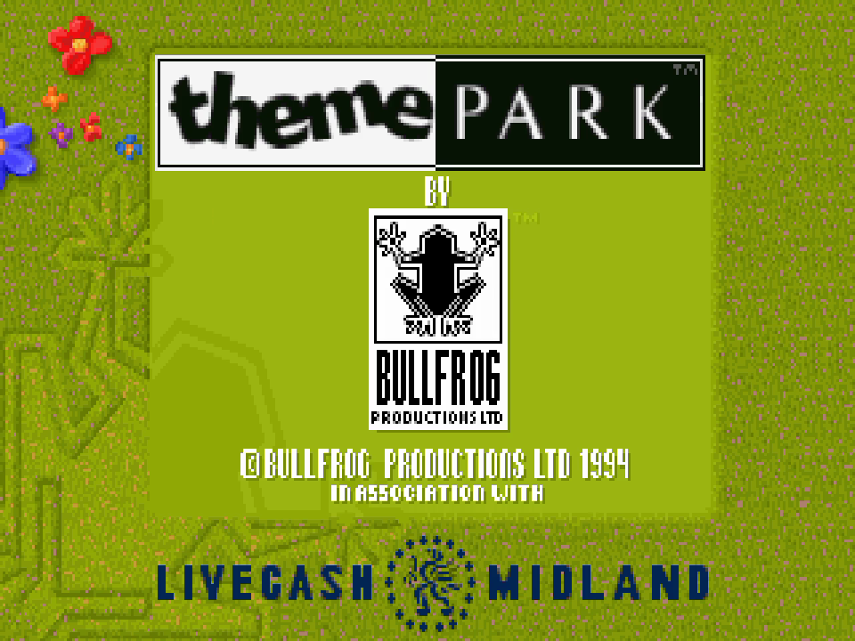
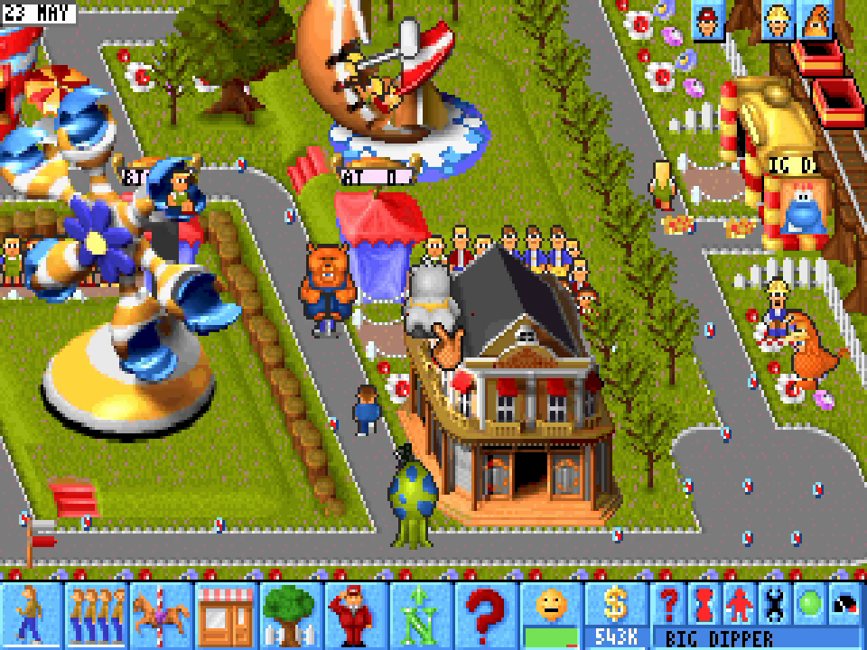
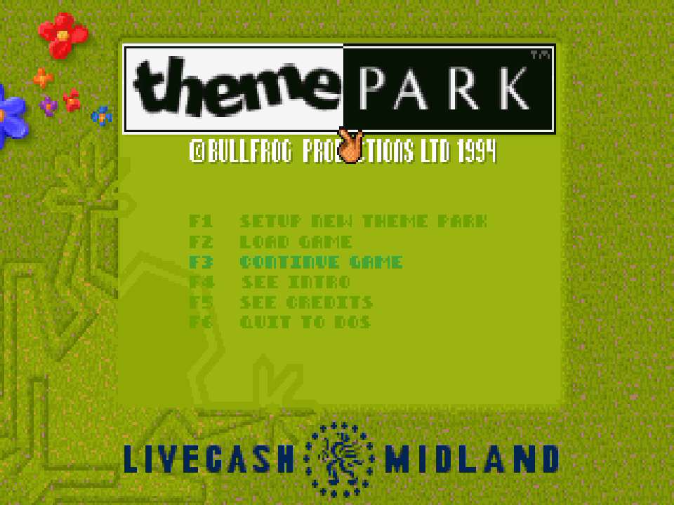
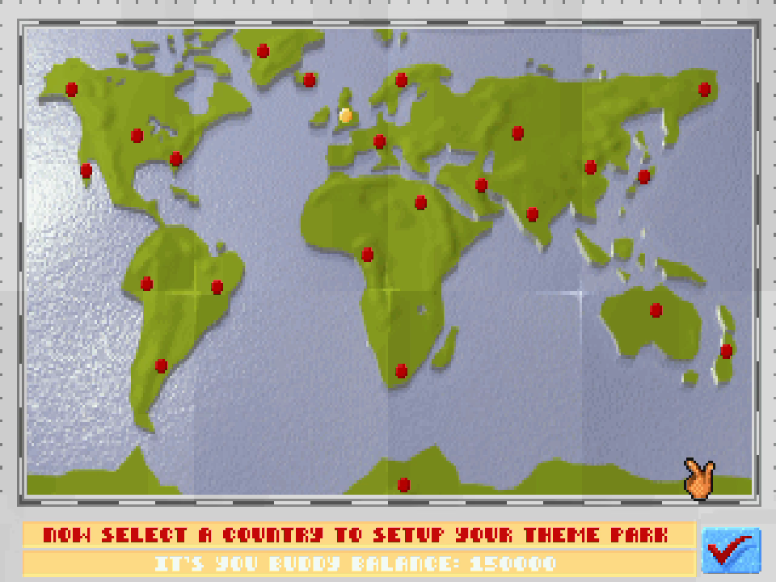
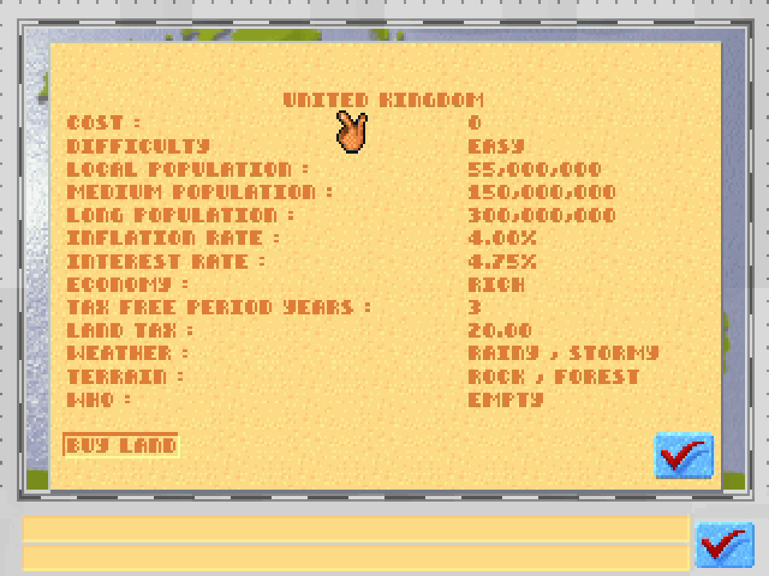
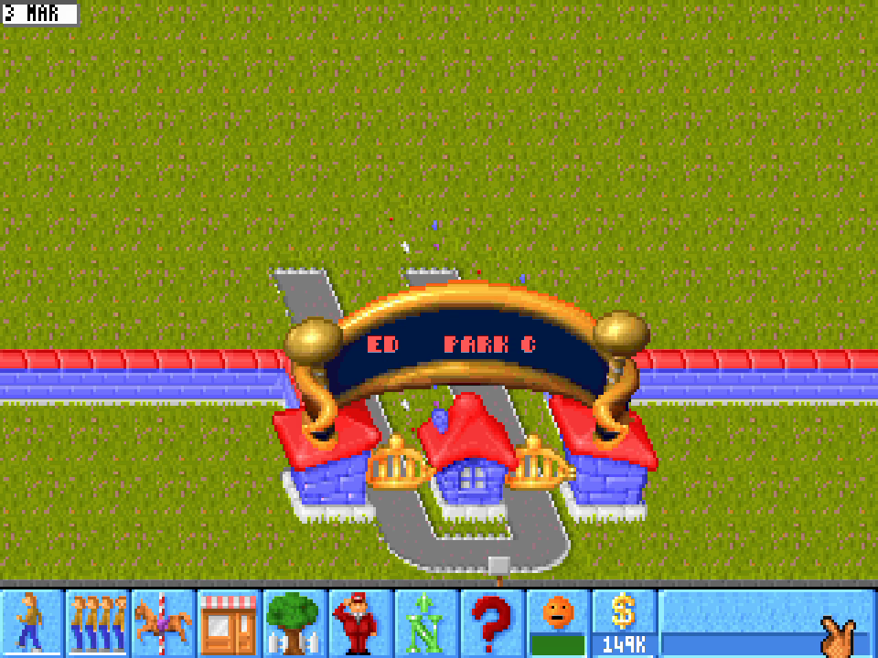
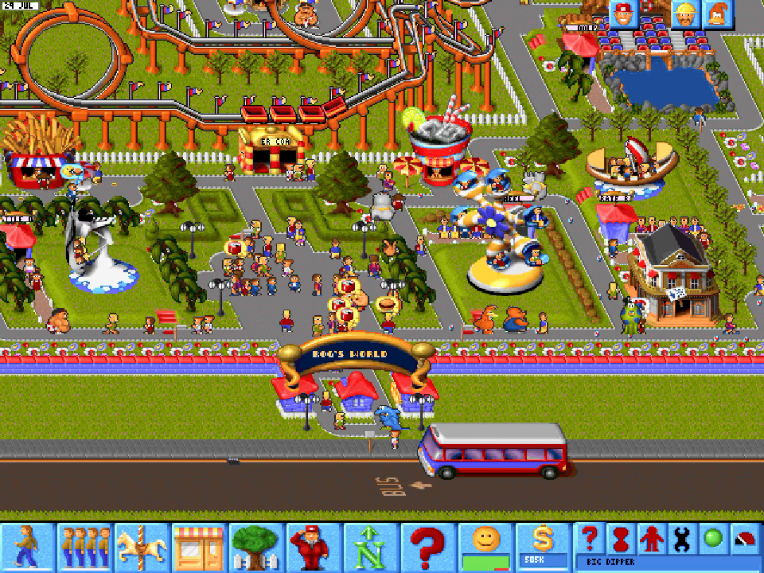

# Theme Park — static recompilation

A static recompilation of Bullfrog's **Theme Park** (DOS, 1994) to a native
Windows and Linux program. The game's own 32-bit code is translated to C by
[pcrecomp](https://github.com/sp00nznet/pcrecomp) and runs on its DOS/4GW host;
no emulator and no DOSBox. You supply your own copy (GOG's, or the 1994 CD); nothing
from the game is in this repository.

Part of the [pcrecomp](https://github.com/sp00nznet/pcrecomp) family, and built
in its shared house style: the same pipeline, CLI flags, headless recording and
conformance harness as the other recomp repos.

## Features

What this adds to the 1994 DOS game, beyond running it natively:

- **640x480 parks by default.** The game shipped a hi-res SVGA park view hidden
  behind the R key. It now opens there, and a lifter bug that made it draw
  no rides, buildings or people is fixed (pcrecomp#72). `--lowres` gives the
  original 320x200.
- **Pixels doubled up.** Integer scaling, with window sizes of 1x, 2x or 3x
  the park's 640x480 and borderless fullscreen. Other scaling modes are
  sharp-bilinear, smooth, CRT and nearest, plus a vivid-colour option, all
  drawn with Direct3D 11.
- **Save states.** Nine slots in the settings menu that keep the whole park.
  A state saved in one session loads in a later one (pcrecomp#77).
- **A settings menu (F10).** Save states, window size, scaling, colour, speed,
  fullscreen, mute and the 640x480 default, without remembering hotkeys. The
  choices are kept in `themepark.ini`.
- **Speed control.** The DOS game had no frame limiter, so it ran as fast as
  the PC could and its timers raced. It is now paced at 25 fps, my best guess
  at the original speed, and Ctrl+PgUp/PgDn picks 12 to 120.
- **A modern mouse.** It is captured in the window and moves at your Windows
  pointer speed. Pushing past an edge scrolls the park, as it did on DOS
  (pcrecomp#76). Held keys repeat, so the arrow keys scroll smoothly.
- **Sound without a Sound Blaster.** The effects play from the 44.1 kHz 16-bit
  bank through a host mixer, and the General MIDI score plays on the Windows
  synth. The game's own sound logic is untouched; only the HMI driver layer
  beneath it is replaced.
- **Xbox controller.** The left stick moves the pointer, A and B are the
  buttons, the D-pad scrolls and the bumpers set the speed.
- **The hidden network game, playable.** Bullfrog left a complete 2-4 player
  game in, reachable only with `-m N` and 1994 NetBIOS. It now runs over TCP:
  `--host N` on one machine, `--join ADDR` on the others. Each player runs
  their own park against the others in a shared world, and Ctrl+T sends
  thugs into their parks. A player who crashes or drops rejoins where the
  game was, and house rules let players give money, share research, and the
  host grant or fine ([docs/multiplayer.md](docs/multiplayer.md)).
- **Mods.** `--mod NAME` lays `mods\NAME` over the game's files without
  touching them.
- **Native on Linux.** The same lifted C built with gcc and SDL2: every
  feature above, no Wine and no DOSBox. A scripted run leaves the game's memory
  identical byte for byte to the Windows build's (pcrecomp#84).
- **One-click setup** from your GOG install, GOG's offline installer or the 1994 CD
  (`Setup.cmd` on Windows, `./setup.sh` on Linux).
- **Headless runs** for testing: scripted input, `--record` to video with
  sound, save and load on cue, and a conformance check.

## Status

**v0.1.0 — alpha.** The whole game is lifted (6,517 functions, no lift errors)
and runs from the title through the name prompt, menus, new-game setup and
world map into a running park. It has not been played for long by a person
yet. Sound effects and music play through the host (HMI SOS replaced;
[docs/sound.md](docs/sound.md)). What is next is on the [roadmap](ROADMAP.md).

| Area | State |
|---|---|
| Opening film | INTRO.EXE lifted too, played before the title with its music and voices (Esc or Space skips it) |
| Boot, title, attract demo | works |
| Name prompt, main menu, setup screens, world map | works |
| Park simulation (calendar, visitors, money) | runs; long play untested |
| Keyboard and mouse | work; a click in the picture captures the mouse, Alt+Tab or F10 frees it |
| Xbox controller | mapped onto the mouse and keys; not yet tried with a real pad |
| Mods | a folder laid over the game's files ([mods/README.md](mods/README.md)) |
| Settings menu (F10) | scaling, colour, speed, fullscreen, mute, 640x480 default |
| 640x480 SVGA mode | the game's own hi-res park view, now the default (R toggles, `--lowres` for the original) |
| Wider parks | the park at any width from 640 to 1920 at 480 high (16:9 is 856x480): F10, *Park resolution*, or `--res`; the panel stays 640 wide ([docs/resolutions.md](docs/resolutions.md)) |
| Sound effects | each group on or off in F10, *Sound effects*: sales, booing, being sick, thugs' motorbikes and more ([docs/sound.md](docs/sound.md)) |
| Modern rules | fixes to the 1994 game's staff, guests and building, each off until ticked in F10, *Modern rules*: guards that chase thugs, guests that get unstuck, an advisor that keeps advising, entertainers that entertain, handymen that stay on their paths, fences under track, lamps and fountains on paths, lamps that light up in storms, Esc that closes windows ([docs/rules.md](docs/rules.md)) |
| Sound effects | host mixer, 44.1 kHz 16-bit (the SB16 bank) |
| Music | the game's General MIDI songs on the Windows synth, or a music pack of recordings (F10, *Music*; [music/README.md](music/README.md)) |
| Save states | 9 slots in the settings menu (F10) |
| The game's own saves | untested |
| Own presenter | Direct3D 11: integer (pixels doubled up, the default), sharp-bilinear, smooth, CRT, nearest (F12); window 1x / 2x / 3x of 640x480; vivid colour (F9), borderless fullscreen (F11); GDI fallback |
| Linux | native (gcc, SDL2): conformance 6/6 and save states checked headless; the window, mouse and pad not yet played by hand; music needs a GM synth on ALSA (FluidSynth, TiMidity++) |

Conformance (`tools/conformance.py`): **6/6 milestones** — title, name prompt,
main menu, park calendar running, no faults, no unresolved dispatches.

## Screenshots

Real output of the recompiled game.

| | |
|---|---|
|  |  |
|  |  |
|  |  |
|  | |

## Getting Started

You need Windows 10 or 11 (x64), or Linux (below), and Theme Park: from GOG, either installed
through GOG Galaxy or GOG's offline installer
(`setup_theme_park_1.01_cs_(77027).exe`), or the original 1994 CD (the UK
release or EA's CD-ROM Classics reissue; mount an ISO by double-clicking it).
The CD's MAIN.EXE is GOG's except for two small mouse fixes GOG made, which
`run_lift.py` applies, so both build the same program.

Which copies work (checked against the discs on archive.org):

| Copy | Works | Notes |
|---|---|---|
| GOG (installed, or its offline installer) | yes | |
| The 1994 CD, any pressing: UK/Europe, US, EA's 1996 and 1998 reissues, CD-ROM Classics, the Japanese two-game disc with Magic Carpet | yes | the same MAIN.EXE and the same data on all of them |
| The floppy release (1.44M disks) | no | an earlier build of MAIN.EXE (packed with RNC); fewer ride films |
| The 1996 Asian release (Chinese, Japanese) | no | its own build, MAINCH.EXE, which draws Chinese and Japanese text |
| The 1994 demos | no | builds of their own |

Every CD carries the game in English, German, Italian, Spanish and French:
F10, *Language* (from the next start), or `--lang 0`-`4`. For anything else,
`run_lift.py` stops and prints the file's SHA-1, and an issue with that is
welcome.

### The installer (easiest)

From the [releases](https://github.com/sp00nznet/themepark-recomp/releases),
download the installer for your system:
`ThemePark-Recomp-Installer-windows-x64.exe`, or
`ThemePark-Recomp-Installer-linux-x64.tar.gz` (unpack it, then run it).

1. It finds GOG's install by itself. Otherwise, **Choose folder…** and pick
   one of these:
   - the Theme Park folder;
   - the CD's drive (a mounted ISO works too);
   - the folder holding GOG's `setup_theme_park_*.exe`.
2. **Build**: it downloads this repository and pcrecomp, then runs the same
   setup as below with no questions. On Windows, a first build installs the
   compilers it needs. On Linux, it tells you which packages to install.
3. **Play**. Next time it opens straight to this.

Nothing of the game is in the installer. The build is made from your copy and
stays on your machine. The installer isn't signed: Windows SmartScreen asks
first (**More info**, **Run anyway**).

### Quick start

1. Download this repository (green **Code** button, **Download ZIP**) and unzip
   it somewhere without an `&` in the path, for example `C:\themepark`.
2. Double-click **`Setup.cmd`**.
   - It checks for Python 3, the `capstone` and `pefile` packages, the pcrecomp
     toolkit, Visual Studio 2022 with C++, LLVM (clang-cl), CMake and Ninja, and
     asks before installing anything missing.
   - It finds your GOG install (or the GOG installer in this folder or your
     Downloads) and asks for the path if it can't. For the CD, give it the
     drive (`D:\`); it sets up `THEME.CD\` the way the CD's installer did.
   - It lifts the game to C (a few minutes), then builds it (5 to 20 minutes).
   - If a step fails it says what to do in one sentence; the details are in
     `setup.log`. Run it again and finished steps are skipped.
3. Double-click **`Theme Park (recomp).cmd`**.

### Step by step

The Quick start runs exactly these commands.

1. Prerequisites:
   - Python 3.10+ (`py -3 --version` prints `Python 3.x`; if `python` opens
     the Microsoft Store, use `py -3`, or turn off the Store alias in
     Settings > Apps > Advanced app settings > App execution aliases).
   - `py -3 -m pip install --user capstone pefile`
   - Visual Studio 2022 (or Build Tools) with *Desktop development with C++*,
     LLVM 17+ (`winget install LLVM.LLVM`), CMake 3.20+, Ninja. Open a new
     terminal after installing so PATH picks them up.
2. Put [pcrecomp](https://github.com/sp00nznet/pcrecomp) beside this folder as
   `..\tools` (or set `PCRECOMP` to its path):
   ```
   git clone https://github.com/sp00nznet/pcrecomp ..\tools
   ```
3. Put your game in `game\` (it must contain `GAME\MAIN.EXE` and `THEME.CD\DATA`):
   ```
   innoextract -s -d game "setup_theme_park_1.01_cs_(77027).exe"
   ```
   or copy your GOG install folder to `game\`. From the CD, copy the whole
   disc to `game\`, clear the read-only flag (`attrib -R game\* /S /D`), then
   make `game\THEME.CD\` as its installer did: `DATA\` holding the 32 files
   listed in `tools\setup.ps1` (`$HdFiles`) copied from `GAME\DATA`, a copy of
   `GAME\SAVE`, and a `SNDSETUP.INF` reading `SOUNDFX = SB16 220 7 1` and
   `MUSIC = GENERAL 330 0 0`.
4. Lift:
   ```
   py -3 run_lift.py
   ```
   The first run builds the function catalog (`analysis\d32_funcs.json`, a few
   minutes). It ends with:
   ```
   ============================================================
     functions 6517   errors 0   files 17   lines 911,510   8.3s
   ============================================================
   ```
5. Build: `build.cmd`. The result is `build\themepark.exe`.
6. Run: `build\themepark.exe`.

Usual trip-ups: `py` vs `python` (above); a path with `&` in it breaks the
build; a pcrecomp checkout older than the DOS host stops the configure with
`pcrecomp at ... has no runtime/dos32` — `git -C ..\tools pull`.

### Linux

A native program, built with gcc and SDL2. Checked on Debian 13; any recent
distribution should do.

1. The packages (Debian and Ubuntu names; `setup.sh` gives Fedora's and Arch's):
   ```
   sudo apt install gcc cmake python3 python3-pip git pkg-config libsdl2-dev libasound2-dev innoextract
   ```
2. `./setup.sh`, or `./setup.sh /path/to/the/game` (the folder holding
   `GAME/MAIN.EXE`, the mounted 1994 CD, or GOG's `setup_theme_park_*.exe`). It does what
   `Setup.cmd` does: fetches pcrecomp beside this folder as `../tools`, copies
   the game into `game/`, lifts (pip installs `capstone` and `pefile` for your
   user if they are missing), builds `build-linux/themepark` and leaves
   `./themepark.sh`. Run it again and finished steps are skipped.
3. `./themepark.sh`

Music: Theme Park's score is General MIDI, played on the first synth on ALSA's
sequencer. Start one before the game, for example
`fluidsynth -is -a pulseaudio /usr/share/sounds/sf2/FluidR3_GM.sf2` (package
`fluidsynth` and `fluid-soundfont-gm`) or `timidity -iA`. `TP_MIDI=128:0`
picks a port by its ALSA address. Without one the game plays its effects and
no music.

`./build-linux.sh` rebuilds after a change.

## Usage

On Linux the program is `./themepark.sh` (or `build-linux/themepark`), with
the same options; its settings menu is a row of dialogs.

```
themepark.exe                       play in a window: F10 for the settings menu (save states, window
                                    size, scaling, speed...); F12 scaling, F9 vivid colour,
                                    F11 / Alt+Enter fullscreen
themepark.exe --fps 35              the game's speed: frames per second (default 25; Ctrl+PgUp/PgDn in game)
themepark.exe --nointro             straight to the title, no opening film ([game] intro=0 to keep it so)
themepark.exe --res 856x480         a wider park: 640 to 1920 wide, 480 high (F10, Park resolution)
themepark.exe --lowres              parks in 320x200, as the original started (R toggles either way)
themepark.exe --scale crt           scaling: integer (default), sharp, smooth, crt, nearest
themepark.exe --fullscreen          borderless fullscreen;  --gdi: no Direct3D;  --vsync 0
themepark.exe --mute                no sound
themepark.exe --mod NAME            play with mods\NAME laid over the game's files (mods/README.md)
themepark.exe --music NAME          the songs from music\NAME, a pack of recordings (music/README.md)
themepark.exe --host 2              network game, 2 to 4 players: this machine hosts (TCP 7790, --port P)
themepark.exe --join 192.168.1.20   ...and the others join it (docs/multiplayer.md); Ctrl+T sends thugs;
                                    also F10, Network game, which has the house rules (give money, share research)
themepark.exe --lang 1              language: 0 English (default), 1 German, 2 Italian, 3 Spanish, 4 French
themepark.exe --headless --seconds 60 --record out.mp4
                                    no window: run 60 guest seconds and film it (needs ffmpeg)
themepark.exe --headless --seconds 90 --click 10:160,100 --key 13:14 ...
                                    scripted input at guest times (game pixels, set-1 scancodes)
```

Click in the picture to play: the window captures the mouse, as the game reads
how far it moves rather than where it is (which is also how pushing past an
edge scrolls the park). Alt+Tab, the Windows key or F10 gives it back (on
Linux, F10 or leaving the window). In a
park, O (or a click on the right-hand ticket booth) opens the gates.

**Save states**: F10, *Save state* or *Load state*, slots 1 to 9, kept in
`states\` beside the exe (about 8 MB each). A state saved in a park loads in a
park, in this session or a later one; not from the title or the menus, and not
into a different build.

An Xbox controller works alongside the mouse: left stick the pointer, A / B
the buttons, D-pad or right stick to scroll, LB / RB speed, Y the 640x480
switch, X Space, Start Esc, Back F1 (not yet tried on a real pad).

Display choices are remembered in `themepark.ini` beside the exe (`[display]
scale`, `vivid`, `fullscreen`, `vsync`, `window`; `[game] fps`, `hires`, `intro`, `res`).

Headless runs keep their own clock, so the same script gives the same run every
time, faster than real time. Debugging aids (`--watch`, `--dump`, `--log`,
`DOS32_BREAK`) are in [docs/testing.md](docs/testing.md).

## Building from source

`run_lift.py` then `build.cmd`, as in Step by step. `build.cmd` configures a
64-bit clang-cl build with Ninja into `build\` (set `BUILD_DIR` for another
folder, `PCRECOMP` for another toolkit). On Linux, `python3 run_lift.py` then
`./build-linux.sh` (gcc, into `build-linux/`). The lift is the same on both
systems, so either can build from the other's `src/recomp/gen/`. The lifted C
is generated from your copy of the game on your machine and is never
distributed.

- [docs/architecture.md](docs/architecture.md): how the pieces fit.
- [docs/pacing.md](docs/pacing.md): why the game needs a frame limiter it never had.
- [docs/testing.md](docs/testing.md): headless runs, scripted input, the conformance harness.
- [docs/sound.md](docs/sound.md): how HMI SOS is replaced.

## License

MIT for the code in this repository ([LICENSE](LICENSE)). Theme Park is © 1994
Bullfrog Productions / Electronic Arts; this project contains none of it and
needs your own copy.
