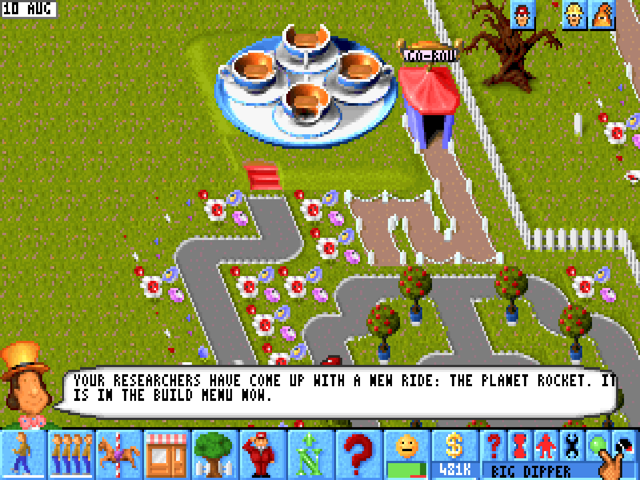
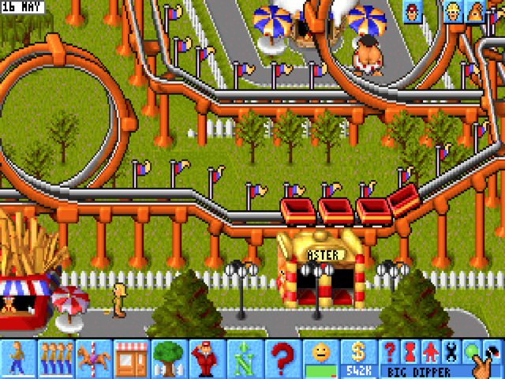
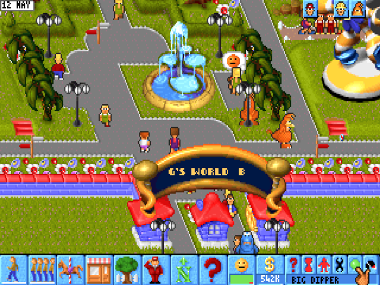
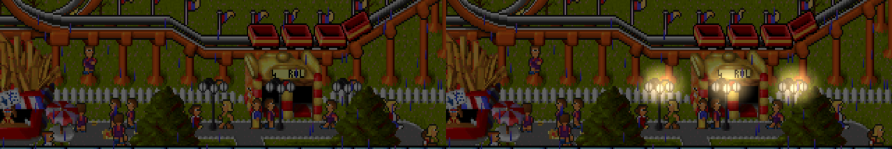
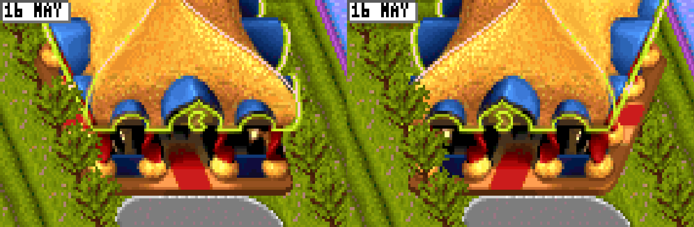

# Modern rules: fixes to how the 1994 game plays

Theme Park was rushed out in 1994, and some of its staff and guests never
quite worked: guards stand still while thugs go by, guests fence themselves
into corners and stay there, and the advisor falls silent an hour in. The
recomp keeps the game as Bullfrog shipped it, and offers changes to these as
**modern rules**: each one is **off** until you turn it on.

## Turning them on

F10 (or a right-click on the bars), *Modern rules*, then tick the ones you
want, or *Turn all on* / *Turn all off*. They take effect at once and are
kept in `themepark.ini`:

```ini
[rules]
guards=1
unstick=1
advisor=1
entertainers=1
handymen=1
building=1
lights=1
esc=1
deal=1
```

For one run, `--rules guards,unstick` turns exactly those on (and the rest
off); `--rules none` turns them all off.

**In a network game** everyone plays by the host's rules: the host's travel
to each player as they join, and the menu shows them but cannot change them
until the game is over. The rules change the simulation, and every machine
in a network game must run the same one.

## The rules

### Guards go after thugs nearby (`guards`, issue #8)

**In 1994:** a guard on patrol stands where you put it, turning now and then.
Every 16 seconds it looks once in the way it faces, one to five tiles along
the path, and only a thug standing right there sets it walking. A thug a
tile off to the side, or behind, goes unseen. It catches a thug on its own or
the next tile, and walks it out of the park.

**With the rule:** about once a second, a patrolling guard that is not busy
heads for the nearest thug within 12 tiles, by the game's own walking, and
catches it there as before. Put guards where thugs come in, and they deal
with them.

In the demo park, with one guard and 12 thugs sent in over 15 minutes, the
guard caught 5 without the rule (6 were still loose at the end) and all 12
with it, each in less than half the time.

The rule also lets go of a thug whose guard has stopped walking it out. In
1994 a caught thug follows its guard until she throws it out at the gate,
and nothing else frees it: pick the guard up and drop her somewhere else and
the thug paces round her for good; fire her and it freezes where it is. With
the rule it goes back to roaming, and any guard can catch it again.

### Stuck guests find their way out (`unstick`, issue #17)

**In 1994:** a guest who cannot find a way out (usually one fenced or hedged
into a pocket, or one the game's short search loses in a maze of paths)
stands still, asking again every two seconds, and the advisor tells you bad
planning has got someone stuck. They stay until you clear a way.

**With the rule:** after a few failed tries (up to about 8 seconds) the guest
is moved. If it is in a pocket with no way to the gate, it goes to the nearest
tile that has one; if there is a way the game's search missed, it goes 8 tiles
along the shortest one. Then it walks on as usual. Guests and paths are
otherwise unchanged, so the advisor's message still appears while someone is
stuck, but only for those few seconds.

### The advisor keeps advising (`advisor`, issue #16)

**In 1994:** each piece of advice waits longer before it can come again the
more often it has been given, and the count is never reset, not even by a
new game. An hour in, most advice has gone quiet, and what is left is the
few messages that ignore the wait (rides wearing out, guests stuck). And the
advice to raise a shop's prices is worked out from a running total that only
grows, so after a while it suggests prices twenty times what anyone pays.

**With the rule:**
- the wait stops growing after the fourth time, so useful advice comes back
  about once a game month;
- in mid November, the advisor warns that the year ends next month;
- when research finishes a ride or shop, the advisor says which, and that it
  is in the build menu (the flashing research button still works as before);
- the shop-price advice sees that running total capped, so it asks for at
  most about twice a shop's base price.



These are on your screen only: what the advisor says is not part of the
simulation, so they never change a network game's other machines.

### Entertainers entertain (`entertainers`, issue #29)

**In 1994:**
- When the guest an entertainer is performing for walks off, it drops to
  standing for one tick, facing a set way, and picks the next guest the tick
  after. That shows a frame of another animation every 16 ticks: the flicker.
- Walking, every tile starts the walk animation again. Fully trained staff
  cross a tile every 2 ticks, so they never get past the first frame and seem
  to flicker between facings as they glide along.
- Its panel's PEOPLE ENTERTAINED misses most of the guests it cheers up (it
  counts only those in another column of tiles), and PEOPLE MADE HAPPY is
  never counted at all: it always shows 0.
- Picking up and dropping any member of staff sets their speed back to
  untrained, until the next training finishes.

**With the rule:** the next guest is picked at once, a walk keeps its
animation going along a straight line, every guest cheered up counts, a guest
cheered up past the park's mood threshold counts as made happy, and dropped
staff keep their trained speed. In the demo park the entertainers' made-happy
total over 5 minutes goes from 0 to about 1200.

What is not changed: an entertainer knocked out by a thug still quits when
it comes round, unless you pick it up and drop it first (that saves it, as it
always did).

### Handymen stay on the job (`handymen`, issue #7)

**In 1994:**
- After a strike, a handyman walks back from the picket line and takes up
  his work wherever the walk ends. On grass that means mowing it, patrol
  area or not, and the picket line is outside the park.
- A handyman who ends up off the paths, on anything but grass (a ride, a
  shop, after a failed walk), goes to a fixed lawn near the top of the park
  and mows it, and from there whatever lawn joins it.
- Each leg of a patrol uses a short search that cannot go round much; a
  waypoint it cannot reach is skipped. And setting a patrol leaves the quick
  preview walk's state behind, so the patrol wanders off for minutes. The
  more waypoints, the worse.

**With the rule:** back from a strike, or off the paths, a handyman goes to
the nearest path and on to his patrol, if he has one; with a patrol, he does
not mow his way out of it; and each patrol leg takes the shortest way along
the paths. A handyman you drop on a lawn with no patrol still mows it, as
before. In the demo park, a 6-waypoint patrol goes round in order three times
in 3 minutes; without the rule the handyman roams for over 3 minutes first.

Not changed yet: handymen bunching in one part of the park. They look for
litter only 5 tiles straight ahead, so a handyman never leaves the area he
was hired in; give them patrols.

### More room to build (`building`, issues #23, #21, #15)

**In 1994:**
- Paths and queues go under raised track (coasters, the big dipper, the
  water splash, the monorail), but hedges, walls and fences do not.
- Lamp posts go only on grass, though the prototypes had them on paths.
- In a busy park, track pieces stop building: the pointer shows a piece
  fits, and the click does nothing. Track pieces are kept in the same table
  as the guests, which guests may fill to all but 100 places (and a second
  way guests arrive fills those too); every piece needs one.
- A fence never goes on a tile someone is standing on. The grass by the gate,
  which guests cross all day as they leave the path, can hardly be fenced.
- The camera stops with the back wall of the park at the very top of the
  screen, under the date and the staff buttons, so building along the back
  is fiddly and the cursor keys can't scroll you any further. The cursor
  keys, though, scroll far off the right of the park and below the gate.
- With someone standing on it, the bulldozer takes a path before the lamp on it.
- Nothing can be built on the row just inside the front wall: making a park
  locks the whole row, apart from the gate.

**With the rule:** fences of every kind go under raised track, and where
people stand (they step aside to the nearest grass or path); the camera
scrolls 3 rows past the back wall (with the keys, the mouse, and the
edge scroll while placing things), with grass drawn beyond it (the pointer
there picks the wall's row, so nothing can be built off the map), and the
cursor keys stop at the park's other edges where the mouse does; the row
inside the front wall is unlocked (and locked again when the rule is turned
off, where it is still bare grass); lamp posts go
on plain paths (not queues or bridges), guests walk past them, and the
bulldozer takes the lamp before the path; fountains
go on paths too, say in the middle of a square, with the paths round them
joined up and anyone standing there stepping aside (take the fountain away
and the path comes back; a litter bin in the way has to go first); and the
guests leave 150 more places in the table for building. That last one means
up to 150 fewer guests in the park at once (in the demo park after 15
minutes: 700 instead of 792).



The game draws a fence under track without the track's pillars, so the
track looks unsupported there. Rubber tubing and the race track are part of
the ground, not raised, and take nothing under them.



### Lamps light up in the dark (`lights`, issue #18)

**In 1994:** rain and thunderstorms darken the whole park (the game fades
its palette), and nothing lights up.

**With the rule:** lamp posts glow while it is dark, more the darker it
gets, and go out when the weather clears. Only the picture changes: the glow
is added to each frame as it goes to the screen, so the simulation, network
games and save states never see it. Lamps hidden behind something still
glow through it.



There is no night in the game, only weather; each day passes in under a
second, too fast for a day and night clock.

### Esc closes windows (`esc`, issue #43)

**In 1994:** Esc closes the staff window and a few others; the status
window, the finance window and most of the rest only close with their tick.

**With the rule:** Esc closes those too. Each of the game's button actions
has a hotkey (the table at 0x4A7537, 6 bytes an action: two sprites, the
key, a kind); the windows' ticks (actions 3 and 0x18) have none, and the
rule gives them Esc.

The full screens don't use those buttons. Research (0x4E) and the bank
statement (0x40) close on Enter or Space, so with the rule Esc reads as
Enter there (the key read, 0x46E888). The stock market (0x44, tick at
0x43BC83) and the world map from the park (its loop 0x4460D2, tick at
0x44644F) close only on a click on the tick, so Esc clicks it; the pointer
is left there. The stock screen and the park map already close on Esc.
Alt+Esc is Windows' own window switch and never reaches the game.

### Handshake sounds wait for the deal (`deal`, issue #49)

**In 1994:** in a negotiation (0x434EA5), the moment the offer reaches the
demand the game stops the heartbeat and the crowd cheers (0x436243), but the
deal only closes when the demand's hand has finished sliding to its new place
(`[ebp-0x44]` against `[ebp-0x20]`). Until then the cheer starts again every
frame, and if the demand moves away first, the heartbeat is gone and the
cheer comes again at the next near miss.

**With the rule:** stopping the song (0x470990) and the cheer (effect 0x27 at
0x470FE0) are held back while the deal is still pending, so the heartbeat
runs on and the crowd cheers once, at the handshake. Your hand also moves
twice as fast (4 a frame instead of 2, 0x435546/0x435658 in run_lift.py), so
crossing the whole range takes 125 frames of the 620-frame countdown, not 250; the countdown
itself is unchanged.

### Engineers reach their rides (`engineers`, issue #40)

**In 1994:** every engineer's walk is a step at a time with a short search
that heads straight for the target and feels its way round anything in the
way. It gets there in the end round most things, but slowly, and:
- An engineer with no way out at all gives up at once. Engineers have lunch
  on bare grass, which is where gardens get hedged in, so an engineer hedged
  in takes a call, gives it up, has lunch, and takes the same call again,
  every few seconds, until you pick him up and drop him somewhere else.
- Putting the hoarding up and taking it down is a walk to each point round
  the ride, each one with that search. In the demo park the median repair
  spends 14 s putting it up and 23 s taking it down, up to a minute each.
  A walk on the round that fails leaves the ride closed with half its
  hoarding up, and no one comes back for it.
- After a repair he walks to a random tile within 8 and, unless it is grass
  with no other staff on it, tries another: up to 40 s of wandering.

**With the rule:** an engineer's walk takes the shortest way, over anything
the game lets him walk on; an engineer with no way from where he stands is
put on the nearest tile that has one, as stuck guests are; the hoarding's
walks go twice as fast; and after a repair he walks to the nearest free
grass. In the demo park over 10 minutes: 27 repairs instead of 20, a median
of 47 s instead of 69 s, the hoarding 9 s up and 9 s down, and the walk to
lunch 3 s at most.

Not changed: the hoarding's look (new art), and where engineers rest (the
nearest free grass, as in 1994, not a staff room).

## Asked for, and not possible

- **Turning shops and sideshows** (issue #20): the game has one drawing of
  each shop and sideshow, facing one way; only ride entrances and the toilets
  are drawn four ways. Mirroring the drawing (flipping it left to right) does
  not work either: the view is not a symmetric diamond. Rows of tiles run
  straight across the screen and each row further down is shifted right, so
  every receding edge leans the same way, and a mirrored shop leans the other
  way, off the grid. It would still face the viewer, too. Here the arcade,
  as drawn and mirrored: its base no longer follows the hedge beside it.

  

## How they work

`src/runtime/rules.c` holds each rule, with the game's own routine it
replaces and what that routine does in 1994. Each rule is a host function in
place of one of the game's (run_lift.py's `OVERRIDES`): it calls the original
and then, if its rule is on, changes what the original decided. They read and
write only the game's memory, never anything kept on the host, so every
machine of a network game makes the same decisions in the same frame, and a
save state carries everything a rule depends on.

The people (guests, staff, thugs) are 200-byte records; the comment at the
top of rules.c has the fields the rules use.

## Testing them

```
themepark.exe --headless --lowres --seconds 900 ... --rules guards --call 55:422232:c6d:8 --call 56:43c592:0
```

- `--call T:ADDR[:A1[:A2[:A3]]]` calls one of the game's functions at T
  seconds, between frames: `0x41E035 fffffffe` loads the demo park as a
  game, `0x422232 TILE JOB` hires staff (job 8: a guard), `0x43C592 0` sends a
  thug.
- `TP_PEOPLELOG=N` prints every guard and thug every N frames;
  `TP_RULESLOG=1` prints what each rule did.
- `work/ai/guards.sh` (in the development tree) is the guard test above.
